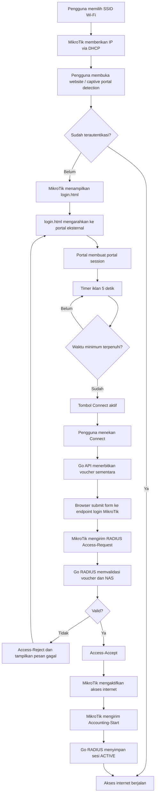
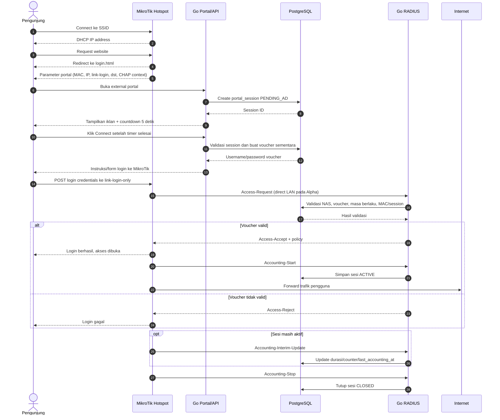
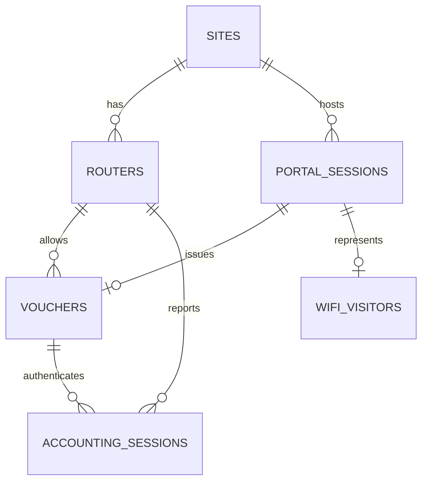

# PRODUCT REQUIREMENTS DOCUMENT (PRD)

# Wi-Fi Advertising & Captive Portal Platform

**Dokumen:** Product Requirements Document  
**Versi:** 0.1 (Draft – Alpha Scope)  
**Status:** Draft untuk persetujuan ruang lingkup  
**Tanggal:** 2 November 2026  
**Platform target:** Web Portal, Go Backend, Go RADIUS Server, MikroTik Hotspot  
**Perangkat awal:** MikroTik RB750 dengan RouterOS 6 (model dan versi tepat perlu diverifikasi)  
**Lingkungan development:** Windows 11  
**Lingkungan production target:** Ubuntu Server LTS / VPS

---

## 1. Ringkasan Produk

Wi-Fi Advertising & Captive Portal Platform adalah sistem yang memungkinkan pengunjung menggunakan Wi-Fi gratis setelah melewati halaman captive portal sederhana. Pada tahap Alpha, pengunjung cukup:

1. Menghubungkan perangkat ke SSID Wi-Fi.
2. Membuka halaman portal yang diarahkan oleh MikroTik.
3. Menunggu hitung mundur iklan selama 5 detik.
4. Menekan tombol **Connect**.
5. Mendapatkan akses internet setelah kredensial sementara diterima oleh MikroTik melalui Go RADIUS Server.

Fokus utama tahap awal bukan membangun platform advertising lengkap. Fokusnya adalah membuktikan **alur koneksi end-to-end** antara perangkat pengguna, MikroTik Hotspot, portal web, Go API, Go RADIUS Server, dan database.

Sistem juga menyediakan pengelolaan voucher sederhana serta tabel pengguna/perangkat Wi-Fi. Voucher digunakan sebagai kredensial teknis untuk login Hotspot. Pengunjung tidak perlu mengetik voucher pada alur Alpha; backend menerbitkan voucher sementara secara otomatis ketika pengunjung menekan Connect.

## 2. Tujuan dan Ukuran Keberhasilan

### 2.1 Tujuan

- Membuktikan bahwa MikroTik Hotspot dapat mengarahkan pengunjung ke portal eksternal.
- Membuktikan bahwa portal dapat menjalankan timer 5 detik dan memulai proses koneksi.
- Membuktikan bahwa MikroTik mengirim `Access-Request` ke Go RADIUS Server.
- Membuktikan bahwa Go RADIUS Server dapat memvalidasi voucher dan mengembalikan `Access-Accept` atau `Access-Reject`.
- Membuktikan bahwa MikroTik mengirim RADIUS Accounting dan Go menyimpan status sesi.
- Menyediakan fungsi dasar untuk membuat voucher dan melihat daftar pengguna/perangkat Wi-Fi.
- Menjalankan seluruh development aplikasi inti secara lokal di Windows tanpa harus menjalankan strongSwan.

### 2.2 Ukuran keberhasilan Alpha

Alpha dinyatakan berhasil apabila:

1. Perangkat mendapatkan IP dari DHCP dan terkena redirect Hotspot.
2. Portal eksternal dapat dibuka dari perangkat yang belum login.
3. Timer 5 detik tampil dan tombol Connect baru aktif setelah persyaratan waktu terpenuhi.
4. Tombol Connect memulai login Hotspot melalui browser ke endpoint login MikroTik.
5. MikroTik mengirim `Access-Request` ke Go RADIUS Server.
6. Voucher valid menghasilkan `Access-Accept` dan akses internet terbuka.
7. Voucher tidak valid, kedaluwarsa, dicabut, atau tidak sesuai perangkat menghasilkan `Access-Reject`.
8. Go RADIUS Server menerima `Accounting-Start`, `Interim-Update` bila dikonfigurasi, dan `Accounting-Stop`.
9. Dashboard menampilkan sesi aktif berdasarkan data accounting, bukan dengan polling langsung ke MikroTik.
10. Seluruh proses dapat diuji pada satu lokasi dan satu router melalui jaringan LAN.

## 3. Prinsip dan Keputusan Arsitektur

| Area | Keputusan Alpha |
|---|---|
| Router / captive portal | MikroTik Hotspot |
| Portal | External Captive Portal berbasis web |
| Backend bisnis | Golang HTTP API |
| Authentication / Accounting | Go RADIUS Server |
| Library RADIUS | `layeh.com/radius` sebagai kandidat implementasi; wajib diuji untuk kebutuhan CHAP dan Accounting |
| Database | Satu PostgreSQL database dengan pemisahan schema logis `app` dan `radius` |
| Voucher | Dibuat dan dikelola oleh Go API; divalidasi oleh Go RADIUS Server |
| Development transport | RADIUS langsung melalui LAN lokal, tanpa IPsec |
| Production transport target | RADIUS melalui IPsec selective tunnel setelah fase integrasi IPsec |
| VPN | strongSwan di Linux VPS pada fase tersendiri; tidak dijalankan pada development harian Windows |
| Integrasi manajemen router | Tidak menggunakan RouterOS API/API-SSL untuk alur login normal Alpha |
| Monitoring sesi | RADIUS Accounting sebagai sumber utama status dan durasi sesi |

### 3.1 Pemisahan tanggung jawab

**Go API Server** menangani portal session, timer iklan, pembuatan voucher, pencatatan pengunjung, dan endpoint untuk dashboard.

**Go RADIUS Server** menangani paket RADIUS dari MikroTik, validasi NAS, autentikasi voucher, keputusan akses, dan accounting.

**MikroTik** tetap menjadi perangkat yang mengontrol akses jaringan. MikroTik membuka akses setelah menerima `Access-Accept` dari RADIUS.

**PostgreSQL** menyimpan data aplikasi, voucher, router/NAS, dan data accounting. Database tidak menjalankan protokol RADIUS; database hanya menjadi penyimpanan yang digunakan kedua service Go.

### 3.2 Voucher bukan dibuat oleh protokol RADIUS

RADIUS adalah mekanisme autentikasi, otorisasi, dan accounting. Voucher dibuat oleh modul aplikasi/backend agar dapat dikelola melalui dashboard. Go RADIUS membaca dan memvalidasi voucher tersebut ketika MikroTik mengirim `Access-Request`.

Dengan demikian, satu voucher dapat mempunyai data bisnis seperti status, waktu kedaluwarsa, batas sesi, dan relasi ke portal session, sedangkan RADIUS hanya menjalankan keputusan autentikasinya.

### 3.3 Tiga kredensial yang berbeda

Ketiga jenis kredensial berikut tidak boleh dicampur:

| Kredensial | Digunakan untuk | Contoh fungsi |
|---|---|---|
| IPsec PSK / certificate | MikroTik ↔ VPS | Identitas router dan perlindungan tunnel IPsec |
| RADIUS shared secret | MikroTik ↔ Go RADIUS | Memvalidasi/melindungi pertukaran paket RADIUS |
| Voucher username/password | Pengunjung ↔ MikroTik Hotspot | Login pengguna Wi-Fi |

Pada Alpha direct-LAN, IPsec belum digunakan. RADIUS shared secret tetap wajib digunakan dan akses UDP 1812/1813 harus dibatasi ke IP MikroTik yang dikenal.

## 4. Ruang Lingkup Alpha

### 4.1 Fitur yang masuk ruang lingkup

#### A. Infrastruktur jaringan

- Satu MikroTik sebagai Hotspot Gateway.
- Satu SSID yang disediakan oleh Access Point terpisah atau perangkat Wi-Fi yang tersedia.
- DHCP untuk jaringan pengunjung.
- Satu Hotspot Server/Profile.
- MikroTik dikonfigurasi sebagai RADIUS Client untuk service `hotspot`.
- RADIUS Authentication menggunakan UDP 1812.
- RADIUS Accounting menggunakan UDP 1813.
- Walled Garden mengizinkan domain portal dan resource minimum yang dibutuhkan portal.
- Komunikasi RADIUS direct melalui LAN pada development/Alpha.

#### B. External Captive Portal

- Halaman portal sederhana, responsif untuk ponsel.
- Menampilkan satu materi iklan statis atau placeholder.
- Menampilkan countdown 5 detik.
- Tombol **Connect** tidak aktif sebelum timer terpenuhi.
- Setelah tombol ditekan, portal memulai proses penerbitan voucher sementara dan login ke MikroTik.
- Menampilkan pesan proses, sukses, atau gagal secara sederhana.
- Tidak ada formulir data pribadi pada Alpha.

#### C. Voucher Management minimum

- Membuat satu voucher uji secara manual dari halaman admin sederhana.
- Menerbitkan voucher sementara secara otomatis untuk portal session ketika pengunjung menekan Connect.
- Username dihasilkan unik dan sulit ditebak.
- Password dihasilkan acak dengan entropi memadai.
- Voucher mempunyai status dan masa berlaku.
- Voucher terikat pada portal session, router/site, dan MAC address yang diharapkan sebagai pemeriksaan tambahan.
- Batas satu sesi aktif per voucher.
- Menampilkan daftar voucher dan statusnya.
- Belum ada batch voucher, cetak voucher, ekspor massal, atau distribusi voucher ke pengunjung.

#### D. Daftar Pengguna / Perangkat Wi-Fi

Pada Alpha, istilah **pengguna** berarti identitas sesi/perangkat Wi-Fi yang tercatat oleh sistem, bukan identitas personal seseorang. Karena belum ada formulir, data minimum yang dicatat adalah:

- MAC address yang dilaporkan Hotspot/RADIUS.
- IP address perangkat.
- Router/NAS dan lokasi.
- Voucher/username yang digunakan.
- Waktu portal session dibuat.
- Waktu autentikasi dan waktu mulai koneksi.
- Status koneksi.
- Durasi sesi.
- Waktu accounting terakhir diterima.
- Total upload/download bila atribut tersedia.

MAC address tidak boleh dianggap sebagai identitas permanen seseorang karena perangkat dapat memakai randomized/private MAC address.

#### E. RADIUS Authentication

- Menerima Access-Request dari NAS yang telah didaftarkan.
- Memilih RADIUS shared secret berdasarkan NAS/source yang terdaftar.
- Memvalidasi voucher, masa berlaku, status, batas penggunaan, dan keterikatan sesi.
- Memvalidasi atribut perangkat dari paket RADIUS, terutama `NAS-Identifier`/`NAS-IP-Address`, `Calling-Station-Id`, dan `Framed-IP-Address` bila tersedia.
- Memberikan `Access-Accept` atau `Access-Reject`.
- Mengirim `Session-Timeout` dan `Port-Limit` bila dibutuhkan oleh kebijakan Alpha.
- Menolak request dari NAS yang tidak dikenal atau shared secret yang salah.

#### F. RADIUS Accounting

- Menerima Accounting-Start.
- Menerima Interim-Update ketika interval dikonfigurasi.
- Menerima Accounting-Stop.
- Memperbarui status sesi di database.
- Menangani paket duplikat secara idempotent.
- Menyimpan atribut session ID, username, NAS, MAC, IP, waktu, durasi, dan counter trafik jika tersedia.

#### G. Admin UI minimum

- Satu akun admin awal untuk penggunaan Alpha.
- Halaman ringkas untuk membuat voucher uji.
- Halaman daftar voucher.
- Halaman daftar pengguna/perangkat dan status koneksi.
- Tidak ada role/permission builder atau dashboard analytics lengkap.

### 4.2 Tidak termasuk ruang lingkup Alpha

- Banyak lokasi/site dan multi-tenant penuh.
- Banyak router per lokasi.
- IPsec, strongSwan, IKEv2, VICI, serta otomatisasi VPN.
- RadSec.
- Pengelolaan router jarak jauh melalui RouterOS API/API-SSL.
- Formulir nama, nomor WhatsApp, email, atau data pribadi pengunjung.
- Manajemen campaign iklan yang dinamis.
- Video ads, tracking engagement kompleks, dan ad network integration.
- Pembayaran atau monetisasi voucher.
- Tarif berbayar, payment gateway, dan paket berlangganan.
- CoA/disconnect jarak jauh dari dashboard.
- Laporan keuangan dan analitik lanjutan.
- Mobile application.
- High availability, multi-region, dan cluster database.

## 5. Business Flow Utama

### 5.1 Flow pengguna



### 5.2 Flow sequence antarkomponen



### 5.3 Penjelasan penting: siapa membuka akses?

Portal tidak membuka akses internet secara langsung. Portal hanya meminta browser mengirim kredensial ke endpoint login Hotspot MikroTik.

MikroTik kemudian mengirim Access-Request ke Go RADIUS Server. Jika RADIUS mengembalikan Access-Accept, MikroTik yang mengubah status perangkat menjadi authenticated dan mengizinkan trafik internet.

Accounting-Start merupakan laporan bahwa sesi sudah mulai aktif. Status `ACTIVE` pada dashboard sebaiknya ditetapkan setelah Accounting-Start diterima, bukan hanya setelah pengunjung menekan tombol Connect atau setelah RADIUS mengirim Access-Accept.

## 6. Rincian Flow Teknis Portal dan Voucher

### 6.1 Parameter redirect dari MikroTik

File Hotspot `login.html` akan dimodifikasi untuk mengarahkan pengunjung ke external portal. Parameter yang relevan dapat mencakup:

| Parameter | Tujuan |
|---|---|
| `mac` | Konteks MAC perangkat dari halaman Hotspot |
| `ip` | Konteks IP perangkat |
| `link-login-only` | Endpoint login Hotspot yang akan menerima form login |
| `link-login` | URL halaman login Hotspot |
| `link-orig` / `dst` | Tujuan awal yang diminta pengunjung |
| `chap-id` | CHAP ID dari halaman login Hotspot |
| `chap-challenge` | CHAP challenge dari halaman login Hotspot |
| `error` | Informasi kegagalan login sebelumnya, jika ada |

Parameter browser tersebut adalah **konteks**, bukan bukti autentikasi. Nilai URL dapat dimodifikasi oleh pengguna. Backend tidak boleh memberikan akses hanya berdasarkan MAC/IP/parameter yang dikirim browser. Keputusan akses akhir harus divalidasi oleh Go RADIUS berdasarkan paket yang benar-benar datang dari NAS terdaftar, termasuk `Calling-Station-Id`, NAS identity, dan atribut terkait.

Nilai `link-login-only` harus divalidasi terhadap host/router yang diizinkan agar portal tidak menjadi open redirect atau mengirim kredensial ke host sembarang.

### 6.2 Countdown iklan

- Durasi Alpha: 5 detik.
- Timer dimulai ketika portal session dibuat dan iklan ditampilkan.
- Waktu mulai disimpan di backend sebagai `ad_started_at`.
- Tombol Connect baru dapat diproses setelah backend memvalidasi bahwa minimal 5 detik telah berlalu.
- JavaScript countdown hanya untuk tampilan; bukan satu-satunya sumber validasi.
- Countdown tidak membuktikan bahwa pengunjung benar-benar memperhatikan iklan.

### 6.3 Penerbitan voucher

Ketika pengunjung menekan Connect:

1. Browser memanggil endpoint Connect dengan portal session token.
2. Go API memeriksa session, status iklan, waktu minimum, masa berlaku session, dan apakah voucher sudah pernah diterbitkan.
3. Go API menerbitkan username dan password acak.
4. Data voucher disimpan ke schema `radius` dan ditautkan ke portal session.
5. Backend mengembalikan instruksi/form login ke browser.
6. Browser mengirim kredensial ke endpoint login MikroTik.
7. RADIUS memvalidasi voucher ketika MikroTik mengirim Access-Request.

Penerbitan voucher harus idempotent. Klik ganda atau retry browser tidak boleh menghasilkan banyak voucher yang aktif untuk satu portal session.

### 6.4 Catatan wajib mengenai HTTP-CHAP

MikroTik Hotspot secara default menggunakan HTTP-CHAP pada banyak konfigurasi. Untuk HTTP-CHAP, halaman login mengolah password dengan MD5 atas gabungan `chap-id`, password, dan `chap-challenge` sebelum mengirimnya ke Hotspot. MikroTik meneruskan informasi CHAP kepada RADIUS dalam atribut `CHAP-Password` dan `CHAP-Challenge` (atau menggunakan Request Authenticator sebagai challenge sesuai kondisi).

RADIUS harus memperoleh password voucher yang dapat dipulihkan untuk menghitung respons CHAP. Hash satu-arah seperti bcrypt/Argon2 saja tidak cukup untuk memverifikasi CHAP. Karena itu, untuk voucher acak yang berumur pendek, secret perlu disimpan dalam bentuk **authenticated encryption** (misalnya AES-GCM dengan key di environment/secret manager) dan hanya dapat didekripsi oleh komponen RADIUS. Secret tidak boleh dicatat di log atau ditampilkan kembali di dashboard setelah penerbitan.

Ini adalah risiko teknis utama yang wajib dibuktikan dalam Phase 0. Jika implementasi memilih PAP, maka transport browser-ke-Hotspot harus dilindungi TLS dengan sertifikat Hotspot yang valid; PAP melalui HTTP biasa tidak boleh digunakan di production. Pilihan metode final ditentukan berdasarkan hasil pengujian RouterOS 6 dan library RADIUS.

## 7. Voucher dan Aturan Akses Alpha

### 7.1 Atribut voucher minimum

| Field | Keterangan |
|---|---|
| `id` | ID internal voucher |
| `username` | Username unik untuk Hotspot |
| `password_ciphertext` | Password voucher dalam bentuk terenkripsi untuk kebutuhan validasi CHAP |
| `status` | Status voucher |
| `site_id` | Lokasi yang diizinkan (Alpha dapat memakai satu lokasi) |
| `router_id` | Router/NAS yang diizinkan |
| `portal_session_id` | Portal session asal |
| `expected_mac` | MAC yang diharapkan, sebagai binding tambahan |
| `created_at` | Waktu dibuat |
| `expires_at` | Batas waktu voucher untuk mulai login |
| `session_timeout_seconds` | Batas maksimal durasi sesi setelah login |
| `used_at` | Waktu voucher mulai terpakai |

### 7.2 Status voucher

- `ISSUED`: dibuat backend dan belum berhasil dipakai.
- `ACTIVE`: sesi sudah dimulai berdasarkan Accounting-Start.
- `USED`: sesi telah berakhir dan voucher tidak dapat digunakan kembali.
- `EXPIRED`: masa berlaku voucher untuk memulai login telah lewat.
- `REVOKED`: dicabut admin/sistem.

Access-Request dapat dikirim ulang oleh NAS ketika tidak menerima respons. Karena itu, retry untuk kombinasi voucher dan sesi yang sama harus ditangani dengan aman. Voucher tidak boleh dianggap habis hanya karena satu paket Access-Request diterima; perubahan status final mengikuti hasil autentikasi dan accounting.

### 7.3 Kebijakan sesi Alpha

- Satu voucher hanya boleh mempunyai satu sesi aktif pada satu waktu (`Port-Limit = 1` atau kebijakan setara).
- Masa berlaku voucher untuk memulai login harus terbatas.
- Session timeout awal ditentukan melalui konfigurasi; nilai awal uji dapat menggunakan 60 menit dan harus dapat diubah tanpa mengubah kode.
- Rate limit mengikuti konfigurasi Hotspot Profile pada Alpha; pengaturan bandwidth dinamis per campaign belum masuk scope.
- Voucher yang sudah selesai digunakan tidak dapat dipakai lagi pada Alpha.

## 8. RADIUS dan Accounting

### 8.1 Authentication

Go RADIUS menerima `Access-Request` dan minimal memeriksa:

- RADIUS client/NAS terdaftar berdasarkan sumber paket dan identitas NAS.
- Shared secret cocok.
- `User-Name` cocok dengan voucher.
- Respons PAP/CHAP dapat diverifikasi sesuai metode login yang dipilih.
- Voucher berstatus dan belum kedaluwarsa.
- Router, portal session, dan MAC sesuai aturan binding.
- Tidak ada sesi aktif lain yang melanggar batas penggunaan.

Jika valid, balas `Access-Accept`; jika tidak, balas `Access-Reject`. Jangan menyertakan alasan sensitif atau informasi kredensial dalam pesan error kepada browser.

### 8.2 Accounting

| Paket | Tindakan backend |
|---|---|
| `Accounting-Start` | Buat/aktifkan sesi berdasarkan kombinasi NAS dan `Acct-Session-Id` |
| `Interim-Update` | Perbarui `last_accounting_at`, `Acct-Session-Time`, counter trafik, dan atribut yang tersedia |
| `Accounting-Stop` | Tutup sesi dan simpan durasi akhir serta terminate cause |

Paket Accounting dapat hilang atau dikirim ulang karena menggunakan UDP. Backend harus idempotent dan tidak boleh membuat sesi ganda ketika paket yang sama diterima kembali. Jika Stop tidak diterima, sesi dapat ditandai `STALE`/`UNKNOWN` setelah tidak ada update dalam ambang waktu; jangan langsung mengasumsikan pengguna logout.

### 8.3 Tampilan durasi

Dashboard membaca database aplikasi. Durasi berjalan dapat dihitung dari `started_at` sampai waktu sekarang untuk sesi `ACTIVE`. Interim-Update digunakan untuk memperbarui counter dan `last_accounting_at`, bukan sebagai satu-satunya sumber hitungan detik durasi.

Interval awal:

- Development/QA: 1 menit agar pengujian cepat.
- Pilot awal: 5 menit sebagai baseline, kemudian disesuaikan berdasarkan kebutuhan monitoring dan kapasitas perangkat.

## 9. Rancangan Database Minimum

Gunakan satu database PostgreSQL, misalnya `wifi_advertising`, dengan dua schema logis.

### 9.1 Schema `app`

| Tabel | Tujuan |
|---|---|
| `admin_users` | Akun admin minimum |
| `sites` | Data lokasi; Alpha hanya satu data |
| `routers` | Informasi router/NAS dan status konfigurasi |
| `portal_sessions` | Sesi pengunjung di portal sebelum/saat login |
| `wifi_visitors` | Identitas perangkat/sesi untuk tabel pengguna |
| `advertisements` | Satu materi iklan statis/placeholder Alpha |
| `audit_logs` | Catatan aktivitas admin penting, minimum |

### 9.2 Schema `radius`

| Tabel | Tujuan |
|---|---|
| `nas_clients` | Router yang diizinkan menjadi RADIUS Client dan referensi shared secret |
| `vouchers` | Kredensial sementara dan status penggunaan |
| `accounting_sessions` | Status sesi aktif/selesai dan atribut accounting terakhir |
| `accounting_events` | Opsional pada Alpha; dapat dipakai untuk audit/idempotensi event |

### 9.3 Relasi utama



### 9.4 Prinsip data

- Gunakan UUID atau ID yang tidak mudah ditebak untuk ID internal.
- Simpan waktu dalam UTC; tampilkan sesuai timezone lokasi.
- Buat unique constraint untuk voucher username.
- Buat unique key sesi berdasarkan NAS + `Acct-Session-Id`.
- Simpan shared secret RADIUS dan password voucher secara terenkripsi atau pada secret manager; jangan simpan plaintext.
- Jangan menyimpan data pribadi pengunjung pada Alpha karena belum ada kebutuhan dan consent untuk itu.

## 10. API Minimum

Nama dan bentuk final endpoint dapat disesuaikan saat desain teknis, tetapi tanggung jawabnya sebagai berikut.

| Method | Endpoint konseptual | Fungsi |
|---|---|---|
| `GET` | `/portal` | Menampilkan portal berdasarkan parameter Hotspot |
| `POST` | `/api/v1/portal-sessions` | Membuat portal session dari konteks redirect |
| `GET` | `/api/v1/portal-sessions/{id}` | Membaca status session portal |
| `POST` | `/api/v1/portal-sessions/{id}/connect` | Memvalidasi timer dan menerbitkan voucher sementara |
| `POST` | `/api/v1/admin/vouchers` | Membuat voucher uji secara manual |
| `GET` | `/api/v1/admin/vouchers` | Daftar voucher |
| `GET` | `/api/v1/admin/visitors` | Daftar pengguna/perangkat Wi-Fi |
| `GET` | `/api/v1/admin/sessions` | Daftar sesi aktif dan selesai |
| `GET` | `/health/live` | Health check proses API |
| `GET` | `/health/ready` | Memastikan dependency penting siap |

Endpoint Connect harus idempotent. Portal session token harus acak, memiliki expiry, dan tidak dapat dipakai untuk menerbitkan voucher berbeda berkali-kali.

Go RADIUS Server tidak perlu menyediakan REST API untuk proses autentikasi internal Alpha. Go API dan Go RADIUS dapat menggunakan repository/database yang sama dengan batas akses yang jelas.

## 11. UI Minimum

### 11.1 Halaman portal pengunjung

Elemen:

- Logo/nama lokasi sederhana.
- Satu materi iklan statis atau placeholder.
- Countdown 5 detik.
- Tombol Connect yang aktif setelah timer selesai.
- Pesan `Menghubungkan...` saat login diproses.
- Pesan sukses/gagal.

Tidak ada:

- Registrasi profil.
- Input nomor telepon.
- Pilihan campaign.
- Form survei.
- Histori penggunaan pengunjung.

### 11.2 Halaman admin

Halaman minimum:

1. **Overview sederhana:** jumlah perangkat aktif dan jumlah voucher.
2. **Voucher:** tombol buat voucher uji dan daftar voucher/status.
3. **Pengguna Wi-Fi:** daftar perangkat, MAC, IP, voucher, lokasi/router, status, waktu mulai, durasi, dan accounting terakhir.

Tidak diperlukan desain dashboard analytics atau branding yang kompleks pada Alpha.

## 12. Fase dan Tahap Pengerjaan

Pengembangan dilakukan bertahap. Setiap fase harus lulus kriteria selesai sebelum fase berikutnya dimulai.

### Phase 0 — Technical Spike / Pembuktian Koneksi

**Tujuan:** Membuktikan kompatibilitas RouterOS 6, external portal, Go RADIUS, CHAP, dan accounting sebelum membangun UI/fitur lebih jauh.

**Scope pekerjaan:**

1. Verifikasi model RB750 dan versi RouterOS dengan `/system resource print` dan `/system routerboard print`.
2. Siapkan satu jaringan Hotspot sederhana dengan DHCP.
3. Jalankan Go RADIUS Server pada Windows dan buka firewall UDP 1812/1813 hanya untuk IP MikroTik lokal.
4. Daftarkan MikroTik sebagai NAS dengan shared secret unik.
5. Uji Access-Request, Access-Accept, dan Access-Reject menggunakan credential uji.
6. Uji external `login.html` redirect menuju portal lokal.
7. Uji HTTP-CHAP end-to-end, termasuk `chap-id`, `chap-challenge`, dan verifikasi CHAP di Go RADIUS.
8. Uji Accounting-Start, Interim-Update, dan Accounting-Stop.
9. Catat atribut RADIUS yang benar-benar dikirim oleh RouterOS 6.

**Deliverable:**

- Catatan konfigurasi MikroTik uji.
- Hasil packet/log RADIUS yang disanitasi.
- Keputusan metode login Hotspot yang akan dipakai.
- Bukti satu perangkat bisa login dan mendapatkan internet melalui Go RADIUS.
- Bukti sesi masuk ke database melalui Accounting.

**Kriteria selesai:** perangkat berhasil melewati portal uji dan mendapatkan akses internet setelah Access-Accept; status sesi dapat dibuktikan dari Accounting. Jika CHAP belum tervalidasi, jangan lanjut ke implementasi voucher produksi.

### Phase 1 — Alpha 0.1: Minimum End-to-End MVP

**Tujuan:** Membuat satu alur yang benar-benar dapat digunakan dari koneksi Wi-Fi sampai internet terbuka.

**Scope pekerjaan:**

1. Buat PostgreSQL database dan migration untuk schema `app` dan `radius`.
2. Buat Go API Server dan Go RADIUS Server sebagai dua proses dalam satu repository.
3. Buat registrasi satu NAS/router dan RADIUS shared secret.
4. Buat halaman portal statis dengan timer 5 detik.
5. Buat endpoint portal session dan Connect.
6. Buat penerbitan voucher otomatis ketika tombol Connect ditekan.
7. Buat halaman admin sederhana untuk membuat voucher uji dan melihat daftar voucher.
8. Buat tabel pengguna/perangkat Wi-Fi.
9. Implementasikan RADIUS Authentication dan Accounting minimum.
10. Jalankan mode `direct` melalui LAN lokal; strongSwan tidak dijalankan.

**Tidak dikerjakan pada fase ini:** multi-site, campaign editor, formulir personal, IPsec, VICI provisioning, laporan kompleks, dan CoA.

**Deliverable:**

- Go API dapat dijalankan pada Windows.
- Go RADIUS dapat dijalankan pada Windows.
- Database migration dan seed awal.
- Portal 5 detik + Connect.
- Voucher generator dan daftar voucher.
- Daftar pengguna/perangkat dengan status berdasarkan Accounting.
- Petunjuk konfigurasi satu MikroTik untuk Alpha.

**Kriteria selesai:** satu perangkat dapat tersambung, melihat portal, menunggu 5 detik, menekan Connect, berhasil login melalui RADIUS, dan tampil sebagai ACTIVE di tabel pengguna. Setelah logout/timeout, status berubah berdasarkan Accounting-Stop atau mekanisme stale yang terdokumentasi.

### Phase 2 — Alpha 0.2: Reliability & Security Hardening

**Tujuan:** Menjadikan alur MVP stabil untuk pilot terbatas.

**Scope pekerjaan:**

1. Penguatan validasi parameter redirect dan allowlist `link-login-only`.
2. Token portal session acak, expiry, dan proteksi replay.
3. Binding voucher ke NAS/router dan MAC yang diharapkan.
4. Penanganan double-click, retry Access-Request, dan accounting duplikat.
5. Penyimpanan password voucher dengan authenticated encryption bila metode CHAP mengharuskannya.
6. Redaksi secret/password dari log.
7. Walled Garden hanya mengizinkan domain dan resource portal yang diperlukan.
8. Timeout, retry, dan error handling RADIUS.
9. Status `STALE/UNKNOWN` jika accounting berhenti masuk tanpa Accounting-Stop.
10. Pengujian voucher expired, revoked, invalid, dan penggunaan ulang.
11. Dokumentasi backup database dan konfigurasi MikroTik.

**Kriteria selesai:** pengujian gagal/berhasil berulang tidak membuat voucher atau accounting session ganda; voucher tidak dapat dipakai lintas router/perangkat yang tidak diizinkan; tidak ada secret di log; portal tetap dapat dibuka sebelum login.

### Phase 3 — Beta Network: VPS dan IPsec

**Tujuan:** Memindahkan komunikasi RADIUS dari LAN development ke VPS dengan jalur aman.

**Scope pekerjaan:**

1. Siapkan Ubuntu Server LTS.
2. Deploy Go API, Go RADIUS, dan PostgreSQL sesuai kebutuhan deployment.
3. Instal dan konfigurasi strongSwan pada VPS.
4. Buat koneksi IKEv2 site-to-site/policy-based antara satu MikroTik dan VPS.
5. Batasi IPsec policy hanya pada trafik RADIUS yang diperlukan.
6. Uji UDP 1812 dan 1813 melalui tunnel.
7. Pastikan portal HTTPS tetap melalui internet biasa, bukan full-tunnel IPsec.
8. Siapkan mode konfigurasi `direct` dan `ipsec` dengan default production `ipsec`.
9. Pastikan mode production tidak fallback otomatis ke RADIUS direct ketika tunnel gagal.
10. Siapkan monitoring tunnel dan RADIUS secara terpisah.

**Kriteria selesai:** satu router lokasi uji dapat melakukan autentikasi dan accounting ke VPS melalui IPsec; ketika IPsec mati, sistem gagal secara tertutup (fail-closed), bukan beralih diam-diam ke UDP publik.

### Phase 4 — Beta: Router Provisioning & Multi-Lokasi Dasar

**Tujuan:** Mengurangi konfigurasi manual saat menambahkan router/lokasi.

**Scope pekerjaan:**

1. Tambahkan pengelolaan site dan router lebih dari satu.
2. Buat identitas/credential IPsec unik untuk setiap router.
3. Integrasikan Go dengan strongSwan VICI untuk load/unload credential dan monitoring koneksi.
4. Buat generator konfigurasi MikroTik (`.rsc`) per router.
5. Admin dapat menambah router dari dashboard dan mengunduh konfigurasi.
6. Tambahkan status online/offline IPsec dan last seen.
7. Pisahkan konfigurasi RADIUS shared secret dari credential IPsec.
8. Uji lebih dari satu router dengan IP publik dinamis/NAT.

**Catatan:** tidak diperlukan RouterOS API untuk alur autentikasi pengunjung. Provisioning awal dapat menggunakan file `.rsc` yang diterapkan teknisi; otomatisasi remote RouterOS API bukan prasyarat fase ini.

**Kriteria selesai:** minimal dua router dapat tersambung ke satu VPS dengan identitas dan credential berbeda, dan keduanya mengirim accounting ke database pusat tanpa tertukar.

### Phase 5 — Pengembangan Fitur Produk (di luar Alpha)

Fitur berikut baru diprioritaskan setelah alur koneksi dan multi-lokasi terbukti stabil:

- Campaign dan jadwal iklan.
- Banyak materi iklan dan video.
- Form registrasi dinamis dan persetujuan privasi.
- Profil pengguna/visitor yang lebih lengkap.
- Pengaturan durasi, bandwidth, dan kebijakan per campaign.
- Dashboard statistik iklan dan penggunaan Wi-Fi.
- Laporan per lokasi/router/periode.
- Role dan permission admin.
- CoA/disconnect dari dashboard.
- Ekspor laporan dan integrasi pihak ketiga.

## 13. Environment dan Mode Operasi

### 13.1 Development Windows

```env
APP_ENV=development
RADIUS_TRANSPORT_MODE=direct
IPSEC_MANAGEMENT_ENABLED=false
RADIUS_AUTH_PORT=1812
RADIUS_ACCOUNTING_PORT=1813
```

- Go API dan Go RADIUS berjalan native di Windows.
- PostgreSQL berjalan native atau melalui Docker Desktop.
- MikroTik mengirim RADIUS ke IP LAN komputer development.
- Windows Firewall mengizinkan UDP 1812/1813 hanya dari IP MikroTik pada jaringan private.
- Tidak diperlukan strongSwan untuk development harian.

### 13.2 Production Ubuntu VPS (Phase 3)

```env
APP_ENV=production
RADIUS_TRANSPORT_MODE=ipsec
IPSEC_MANAGEMENT_ENABLED=true
IPSEC_BACKEND=strongswan
IPSEC_VICI_SOCKET=/var/run/charon.vici
RADIUS_AUTH_PORT=1812
RADIUS_ACCOUNTING_PORT=1813
```

Konfigurasi di atas merupakan contoh nama environment variable, bukan file konfigurasi siap deploy. Mode `ipsec` hanya boleh dinyatakan aktif setelah tunnel, policy, firewall, dan jalur RADIUS diverifikasi.

### 13.3 Aturan fail-closed

- `direct` hanya untuk development/QA atau jaringan privat yang secara eksplisit diizinkan.
- Production menggunakan `ipsec` setelah Phase 3 selesai.
- Jika tunnel IPsec putus, jangan otomatis mengirim RADIUS melalui internet publik.
- Status IPsec dan status layanan RADIUS harus dipantau terpisah.

## 14. Persyaratan Non-Fungsional Minimum

### Keamanan

- RADIUS hanya menerima paket dari NAS yang terdaftar.
- RADIUS shared secret unik per router dan cukup kuat.
- IPsec credential terpisah dari RADIUS shared secret dan voucher.
- Portal HTTPS menggunakan sertifikat valid pada pilot/production.
- Walled Garden hanya mengizinkan domain/resource yang diperlukan.
- Parameter redirect browser tidak dianggap sebagai bukti identitas.
- Voucher acak, berumur pendek, satu sesi aktif, dan tidak bisa digunakan ulang setelah selesai.
- Secret tidak boleh ditulis ke application log.
- PostgreSQL tidak dibuka langsung ke internet.
- VICI hanya diakses lokal dengan permission sistem yang ketat.

### Keandalan

- Endpoint penerbitan voucher idempotent.
- Accounting handler idempotent terhadap paket duplikat.
- Timeout dan retry RADIUS dikonfigurasi dengan jelas.
- Kegagalan database tidak boleh menghasilkan Access-Accept.
- Kegagalan RADIUS tidak boleh membuka akses secara default.
- Perubahan status sesi memiliki timestamp dan sumber event.

### Kinerja

- Query voucher menggunakan index pada username dan status/expiry yang relevan.
- Handler RADIUS tidak melakukan pekerjaan berat atau request HTTP eksternal.
- Accounting dapat diproses cepat; mekanisme batch/queue baru ditambahkan bila pengukuran menunjukkan kebutuhan.
- Interim-Update awal 1 menit untuk QA dan 5 menit sebagai baseline pilot.

## 15. Risiko dan Hal yang Wajib Divalidasi

| Risiko / pertanyaan | Dampak | Mitigasi / keputusan |
|---|---|---|
| Model RB750 dan versi RouterOS belum dipastikan | Perbedaan kemampuan dan konfigurasi | Verifikasi hardware/version sebelum Phase 0 |
| HTTP-CHAP memerlukan password yang bisa dipulihkan oleh RADIUS | Hash satu-arah tidak dapat memverifikasi CHAP | Uji CHAP; gunakan voucher acak dengan secret terenkripsi pada storage |
| Parameter redirect dapat dimanipulasi browser | Portal dapat menerima konteks palsu | Perlakukan sebagai metadata; validasi akhir melalui NAS/RADIUS attributes |
| `link-login-only` dapat dimanipulasi | Risiko open redirect/credential forwarding | Host allowlist dan validasi URL |
| Walled Garden tidak lengkap | Portal/asset gagal tampil sebelum login | Host portal dan asset first-party; uji dari ponsel |
| Accounting-Stop hilang | Sesi tertinggal ACTIVE | Interim-Update, last-seen, stale detection, rekonsiliasi |
| RADIUS UDP melalui internet publik | Risiko keamanan | Direct mode hanya untuk LAN; production memakai IPsec pada fase terpisah |
| Randomized MAC Address | Satu orang dapat tercatat sebagai perangkat berbeda | Gunakan MAC sebagai identitas sesi/perangkat, bukan identitas orang |
| Browser captive portal mini memiliki keterbatasan | Form/redirect dapat berperilaku berbeda | Uji Android, iOS, dan browser normal pada fase hardening |

## 16. Rencana Pengujian dan Acceptance Test

### 16.1 Test koneksi

- [ ] Perangkat mendapat alamat IP DHCP.
- [ ] Perangkat belum login dan diarahkan ke Hotspot.
- [ ] Halaman Hotspot mengarahkan ke portal eksternal.
- [ ] Portal menerima konteks redirect yang dibutuhkan.
- [ ] Portal tampil pada ponsel.
- [ ] Timer berjalan selama minimal 5 detik.
- [ ] Tombol Connect tidak dapat diproses sebelum timer selesai.
- [ ] Klik Connect menghasilkan satu voucher untuk satu portal session.
- [ ] Browser mengirim form login ke MikroTik.
- [ ] MikroTik mengirim Access-Request ke Go RADIUS.
- [ ] Voucher valid mendapat Access-Accept.
- [ ] Akses internet benar-benar dapat digunakan.

### 16.2 Test penolakan

- [ ] Voucher salah mendapat Access-Reject.
- [ ] Voucher kedaluwarsa mendapat Access-Reject.
- [ ] Voucher revoked mendapat Access-Reject.
- [ ] Voucher dari router lain ditolak.
- [ ] MAC yang tidak sesuai ditolak sesuai kebijakan binding.
- [ ] NAS tidak dikenal ditolak.
- [ ] Shared secret salah tidak menghasilkan akses.
- [ ] RADIUS/database tidak tersedia tidak membuka akses.

### 16.3 Test accounting

- [ ] Accounting-Start membuat sesi ACTIVE.
- [ ] Interim-Update memperbarui last accounting dan counter.
- [ ] Accounting-Stop menutup sesi.
- [ ] Paket Accounting duplikat tidak membuat record ganda.
- [ ] Hilangnya Accounting-Stop dapat dideteksi melalui stale detection.
- [ ] Durasi dashboard dihitung dari started_at sampai waktu sekarang untuk sesi aktif.

### 16.4 Test mode jaringan

- [ ] Direct mode bekerja pada LAN development.
- [ ] IPsec belum dijalankan dan tidak menjadi dependency Go API/RADIUS pada Alpha.
- [ ] Pada Phase 3, RADIUS bekerja melalui IPsec.
- [ ] Ketika IPsec production putus, tidak ada fallback UDP publik.
- [ ] Trafik portal HTTPS dan trafik internet pengunjung tidak dipaksa melewati tunnel RADIUS.

## 17. Definition of Done Alpha 0.1

Alpha 0.1 dianggap selesai apabila seluruh kondisi berikut terpenuhi:

- Satu MikroTik RB750 dapat menjalankan Hotspot.
- Satu perangkat pengguna dapat terhubung ke SSID.
- Pengguna melihat portal eksternal dengan timer 5 detik.
- Pengguna menekan Connect dan mendapatkan akses internet.
- Proses login divalidasi oleh Go RADIUS, bukan user lokal MikroTik.
- Voucher dibuat dan tercatat oleh sistem.
- Pengguna/perangkat tercatat pada tabel pengguna.
- Accounting-Start dan Accounting-Stop tersimpan dengan benar.
- Admin dapat membuat voucher uji dan melihat status voucher.
- Aplikasi berjalan lokal pada Windows tanpa strongSwan.
- Seluruh pengujian dilakukan pada satu lokasi dan satu router.

## 18. Referensi Teknis

Referensi berikut digunakan sebagai acuan awal. Perilaku final tetap harus diuji pada model RB750 dan versi RouterOS aktual.

1. [MikroTik – HotSpot Customisation](https://help.mikrotik.com/docs/spaces/ROS/pages/87162881/Hotspot%20customisation) — halaman Hotspot, variabel login, HTTP-CHAP, dan external authentication.
2. [MikroTik – RADIUS](https://help.mikrotik.com/docs/spaces/ROS/pages/328097/RADIUS) — RADIUS Client, attribute Access-Request/Access-Accept, Accounting, dan CoA.
3. [MikroTik – HotSpot / Captive Portal](https://help.mikrotik.com/docs/spaces/ROS/pages/56459266/HotSpot%2B-%2BCaptive%2Bportal) — fitur Hotspot, walled garden, dan konfigurasi dasar.
4. [layeh/radius](https://github.com/layeh/radius) — kandidat library RADIUS Go; dukungan attribute dan perilaku server harus diuji.
5. [RFC 2865 – RADIUS](https://www.rfc-editor.org/rfc/rfc2865.html) — autentikasi PAP/CHAP dan format atribut RADIUS.
6. [strongSwan Documentation](https://docs.strongswan.org/) — acuan implementasi IPsec pada fase VPS.
7. [strongSwan Go VICI Client](https://github.com/strongswan/govici) — kandidat integrasi provisioning/monitoring strongSwan dari Go pada fase lanjutan.

---

## 19. Ringkasan Prioritas Pengerjaan

Urutan yang harus dijaga agar scope tidak melebar:

1. **Buktikan koneksi:** MikroTik → Hotspot → portal → Go RADIUS → internet.
2. **Buktikan voucher:** backend membuat voucher, RADIUS memvalidasi voucher.
3. **Buktikan accounting:** sesi aktif dan selesai masuk ke database.
4. **Buat UI minimum:** tombol buat voucher dan tabel pengguna/perangkat.
5. **Hardening:** keamanan portal, CHAP, retry, idempotensi, dan stale session.
6. **Baru integrasikan IPsec:** strongSwan di Ubuntu VPS dan policy RADIUS-only.
7. **Baru multi-lokasi dan fitur advertising lanjutan.**

**Prinsip utama proyek:** jangan menambahkan fitur advertising, dashboard, atau otomatisasi infrastruktur sebelum satu alur koneksi dari perangkat pengguna sampai internet berhasil dan dapat dibuktikan melalui RADIUS Accounting.
